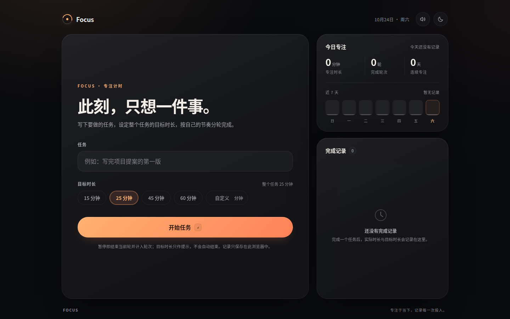
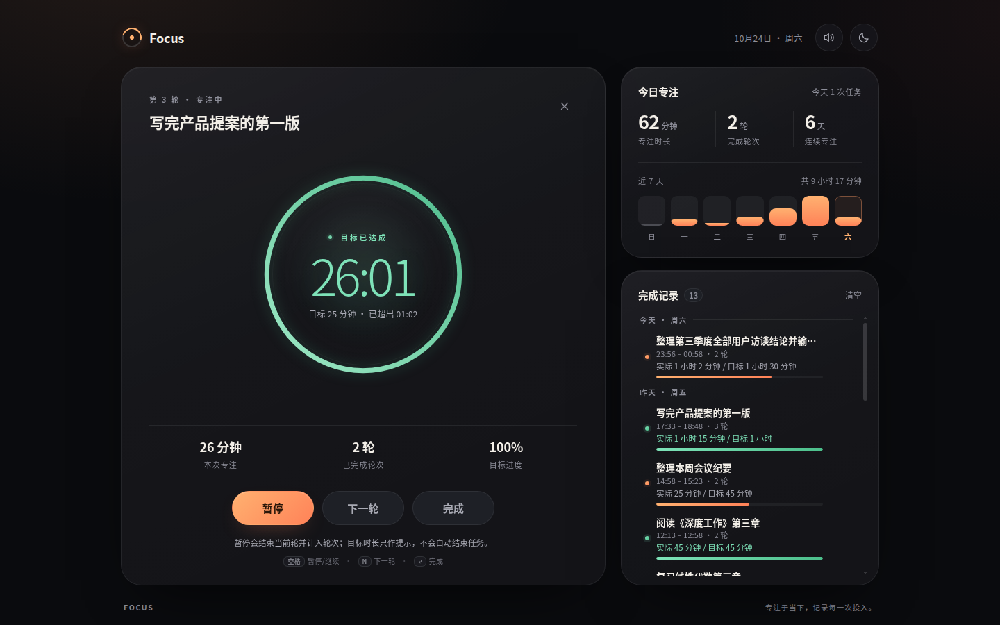

# Focus · 专注计时

一个安静、克制的任务专注应用：为一个任务设定整体目标时长，按轮计时；暂停即结束当前轮但任务继续。计时只累计实际专注时间，目标时长仅作提示与统计参考——不会自动打断你。

纯前端、零依赖，直接打开 `index.html` 即可使用，数据只保存在浏览器本地。



## 它如何计时

- **一个任务，一个目标**：设定任务名和目标时长（整个任务共用），目标只是提示与统计参考。
- **正计时**：从 `00:00` 开始累计实际专注时间；到达目标不会自动结束当前轮或任务，继续专注即进入「已超出」状态。
- **暂停 = 结束一轮**：暂停会结束当前轮并计入轮次，任务本身不结束；「继续」从新一轮接着累计。
- **下一轮**：结束当前轮并立刻开始新的一轮，任务和累计时间保持不变。
- **完成**：结束任务并保存记录，记录同时包含**实际专注时间**与**设定目标时间**。

## 功能

- **设定任务与目标时长**：任务名 + 15 / 25 / 45 / 60 分钟预设，或自定义 1–480 分钟；上次目标会被记住。
- **正计时 + 圆环进度**：显示实际专注时间、距目标剩余 / 已超出时长，圆环表示目标完成度。
- **暂停 / 继续 / 下一轮 / 完成**：暂停计轮、继续开新一轮、下一轮直接切换、完成保存记录。
- **目标达成提示**：到点只提示、不打断，绿色状态提示目标已达成并继续累计。
- **完成记录**：任务名、时间段、轮数、**实际 / 目标** 时长与达成条；按日期分组；单条删除可撤销，支持清空。
- **统计**：今日实际专注时长 / 完成轮次 / 连续专注天数，近 7 天专注柱状图。
- **刷新恢复**：意外刷新或关闭页面后，进行中的任务会结束当前轮并恢复为暂停状态，轮次与实际时间不丢失。
- **体验细节**：深色 / 浅色主题、提示音、空格 / N / Enter 快捷键、页面标题实时显示已专注时间、完成时彩带、响应式布局、`prefers-reduced-motion` 适配。

## 使用

直接双击 `index.html`（Chrome / Edge / Firefox / Safari 现代版本），或在本目录起一个静态服务器：

```bash
python3 -m http.server 4173
# 打开 http://127.0.0.1:4173/
```

### 操作流程

1. 输入任务，设定「整个任务」的目标时长，点「开始任务」（Enter 也可）。
2. 计时从 0 向上累计；到达目标只提示，不会自动暂停或结束。
3. 点「暂停」= 结束当前轮并计入轮次（任务暂停），点「继续」开始下一轮；「下一轮」会结束当前轮并立刻开始下一轮。
4. 点「完成」结束任务，记录中会同时保存实际专注时间与设定目标时间。
5. 完成记录出现在右侧栏，悬停可删除（支持撤销）。

### 快捷键

| 按键 | 作用 |
| --- | --- |
| `空格` | 暂停（结束当前轮）/ 继续（开始下一轮） |
| `N` | 结束当前轮并开始下一轮 |
| `Enter` | 完成并保存记录 |
| `Esc` | 关闭弹窗 |

> 快捷键在焦点不处于输入框 / 按钮时生效；弹窗打开时 `Esc` 关闭。

## 界面

| 专注中（正计时） | 目标已达成 · 继续计时 | 完成记录（实际 / 目标） |
| --- | --- | --- |
|  |  |  |

更多截图见 [`screenshots/`](screenshots/)：浅色主题、暂停态、移动端布局。

## 数据

所有数据保存在 `localStorage`，不会上传：

| Key | 内容 |
| --- | --- |
| `focus.session.v1` | 进行中的任务会话（刷新恢复用，内部结构为 v2，可自动迁移旧数据） |
| `focus.records.v1` | 完成记录（最多 500 条） |
| `focus.settings.v1` | 主题、提示音、上次目标时长 |

清空浏览器数据会一并清除记录。

## 已知取舍

- **目标只是提示**：不会在设定时间自动暂停或结束；你可以自由超时继续，记录里会同时显示实际与目标。
- **暂停计轮的最小单位**：短于 1 秒的轮次不计入轮数，避免误触产生的空轮。
- **刷新精度**：进行中的进度每 4 秒写入本地，刷新最多回退约 4 秒；恢复后任务为暂停态，当前轮按已保存时间计入。
- **自定义时长按整分钟计时**：输入小数（如 `45.5`）会四舍五入取整，开始前提示会显示取整后的结果。
- **本地会话数据异常**：若 `focus.session.v1` 被外部写坏，可能恢复出一个空会话，点 × 放弃即可，不影响完成记录。

## 项目结构

```
Focus/
├── index.html          # 页面结构与文案
├── styles.css          # 设计系统、布局、动效、响应式
├── focus-core.js       # 纯逻辑：任务/轮次状态机、计时、记录、统计、存储（无 DOM）
├── app.js              # UI 绑定：渲染、交互、快捷键、音效、彩带
├── screenshots/        # 桌面 / 移动端界面截图
├── tests/
│   ├── core.test.js    # Node 单元测试（focus-core.js）
│   └── e2e.cjs         # CDP 端到端测试（headless Chrome）
├── qa-report.md        # 独立 QA 报告（缺陷、覆盖清单、截图索引）
├── design-review.md    # 视觉审查与打磨记录
└── README.md
```

## 测试

`focus-core.js` 采用 UMD 包装：浏览器里挂到 `window.FocusCore`，Node 里可直接 `require`，因此计时 / 记录逻辑可以脱离 DOM 做单元测试。端到端测试用 Chrome DevTools Protocol 驱动无头 Chrome，并注入可控时钟把计时快进。

```bash
# 单元测试
node --test tests/core.test.js

# 端到端测试（自动起停 headless Chrome；需要 google-chrome，可用 CHROME_BIN 指定）
node tests/e2e.cjs
```

> Node 24+（端到端测试使用内置 `WebSocket`，无需安装任何依赖）。e2e 会自动复用 `127.0.0.1:4173` 的预览服务器，不可用时自行启动 `python3 -m http.server 4181`。

测试覆盖开始 / 正计时 / 暂停计轮 / 继续下一轮 / 目标达成不自动结束 / 完成保存实际与目标 / 记录与统计 / 刷新恢复 / 删除撤销 / 清空 / 快捷键 / 自定义时长 / 移动端等场景，详见 [`qa-report.md`](qa-report.md)。

最近一次验证：**单元测试 34/34、端到端测试 16/16 通过，0 console error**。

## 设计说明

- 深色为默认主题，暖橙渐变作为唯一强调色；目标达成后切换为克制的绿色状态，计时不中断。浅色主题使用同一套语义变量并单独校准对比度。
- 桌面端（≥921px）为视口高度骨架、左右两栏同底对齐；窄屏改为自然滚动布局。
- 计时基于 `Date.now()` 计算，而非累加 `setInterval` 次数，标签页被节流或电脑休眠后依然准确。

## 浏览器支持

面向现代浏览器（Chrome / Edge / Firefox / Safari 最新版本）。使用 `backdrop-filter`、CSS 变量、Web Audio 等渐进增强特性；不支持时功能仍可用（仅视觉效果降级）。

---

Focus 专注于当下，记录每一次投入。
