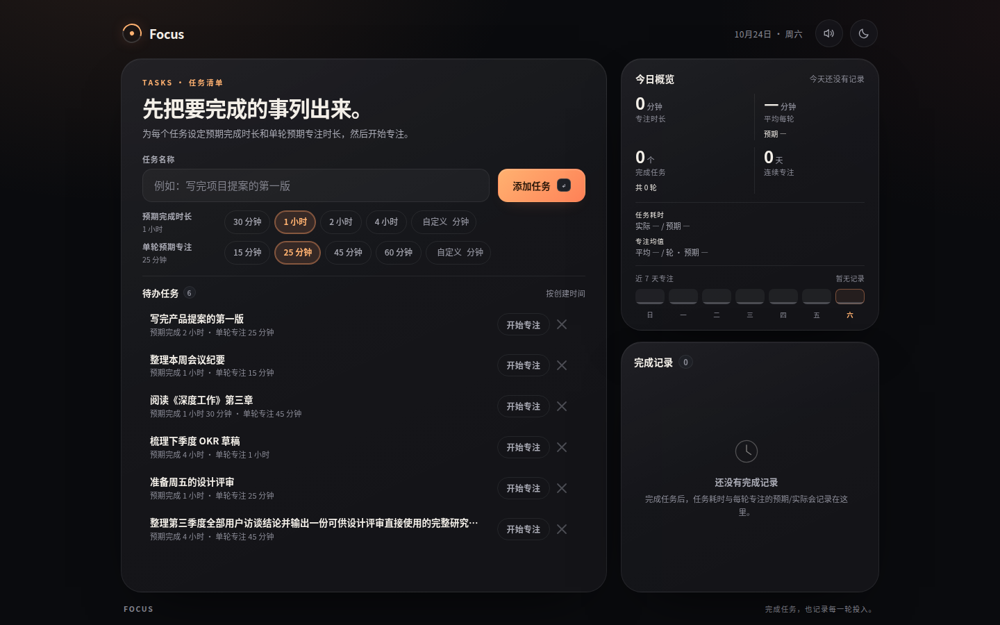
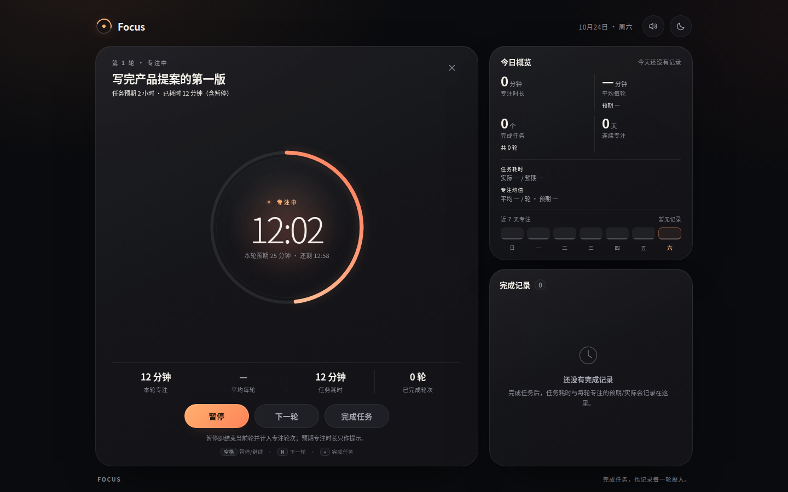
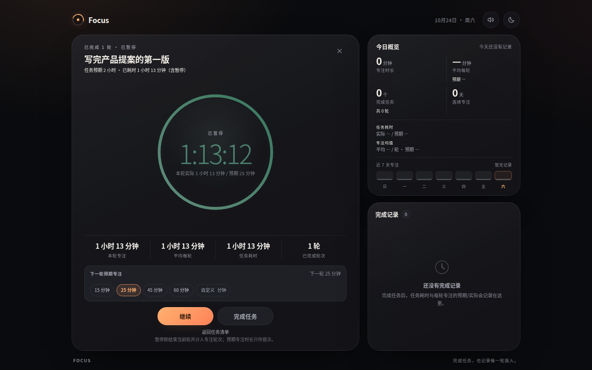
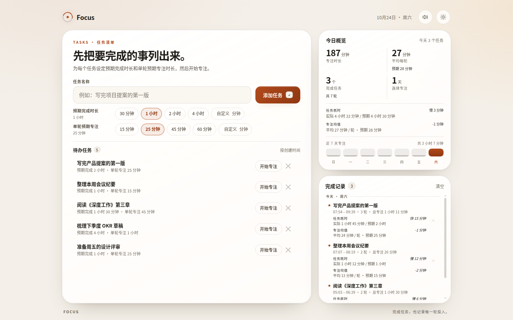

# Focus · 任务与专注

一个安静、克制的任务专注应用：先把要做的事建成待办任务（包含预期完成时长与单轮预期专注时长），再按轮专注。

它刻意区分两种时间：

- **任务耗时**：从第一次开始专注到完成任务的实际墙钟时间（包含轮间暂停）——越短越好，用来衡量任务效率。
- **专注时长**：每一轮实际专注的时间（暂停即结束一轮）——越长越好，用来衡量单次专注质量。

目标时长只作为提示与统计参考，到点不会自动打断你。

纯前端、零依赖，直接打开 `index.html` 即可使用，数据只保存在浏览器本地。

**在线体验：[https://kibiandkimi.github.io/focus/](https://kibiandkimi.github.io/focus/)**



## 核心概念

| 概念 | 含义 | 优化方向 |
| --- | --- | --- |
| 任务（Task） | 类似 todo 的一件事，带**预期完成时长**与默认的**单轮预期专注** | 越少的轮次、越短的任务耗时完成越好 |
| 轮（Round） | 一次连续的专注；暂停或点「下一轮」即结束当前轮 | 越长的平均专注越好 |
| 任务耗时 | 首次开始专注 → 完成任务的墙钟时间，包含轮间暂停 | 实际比预期短 |
| 专注时长 | 每一轮从开始到结束的实际专注时间 | 实际平均比预期长 |

## 功能

- **任务清单**：建立多个待办任务，每个任务包含名称、预期完成时长（30 分钟 / 1 小时 / 2 小时 / 4 小时 / 自定义）与单轮预期专注（15 / 25 / 45 / 60 分钟 / 自定义）。
- **开始专注**：从清单开始任务，弹窗可选择**本轮预期专注时长**；同一时间只允许一个进行中的任务。
- **本轮正计时**：只累计当前轮的实际专注时间；本轮预期专注到达时提示「本轮达标」，但不会自动暂停或结束。
- **暂停 = 结束一轮**：暂停结束当前轮并计入轮次，任务保持进行中；可选择下一轮预期专注后继续。
- **下一轮 / 返回清单**：下一轮结束当前轮并立即开始；返回清单后任务保持暂停，可随时继续。
- **完成任务与记录**：同时记录**任务预期/实际耗时**、**每轮预期/实际专注（平均每轮、总专注、轮次）**、日期与时间段。
- **今日概览**：专注总时长、平均每轮（对比预期）、完成任务数、完成任务轮次、连续天数；另展示今日「任务耗时 实际/预期」与「专注均值 实际/预期」。
- **完成记录**：逐条对比任务耗时与专注均值的预期/实际（快/慢、长/短），支持单条删除撤销与清空。
- **刷新恢复**：进行中的任务会恢复为暂停态，当前轮结束并计入，不丢累计时间。
- **体验**：深色 / 浅色、提示音、空格 / N / Enter 快捷键、任务完成后彩带、响应式布局、`prefers-reduced-motion`。

## 使用

直接双击 `index.html`（现代 Chrome / Edge / Firefox / Safari），或在本目录起静态服务器：

```bash
python3 -m http.server 4173
# 打开 http://127.0.0.1:4173/
```

### 操作流程

1. 在任务清单填写任务名称，选择**预期完成时长**和**单轮预期专注**，点「添加任务」。
2. 在任务行点「开始专注」，在弹窗中确认本轮预期专注时长，开始第一轮。
3. 本轮计时从 0 向上累计；到达预期只提示「本轮达标」，可继续专注。
4. 点「暂停」结束当前轮（任务不结束）；可在「下一轮预期专注」中调整预期，再点「继续」开始新一轮；也可以点「下一轮」直接结束当前轮并开新一轮。
5. 点「完成任务」保存记录；任务耗时 = 从第一次开始到完成的墙钟时间（含暂停），专注均值 = 各轮实际专注 / 轮数。
6. 暂停时可「返回任务清单」；任务进度保留。完成后任务从清单移除，记录出现在右侧。
7. 完成记录悬停可删除（支持撤销），也可一键清空。

### 快捷键

| 按键 | 作用 |
| --- | --- |
| `空格` | 暂停（结束当前轮）/ 继续（开始下一轮） |
| `N` | 结束当前轮并开始下一轮 |
| `Enter` | 完成任务 |
| `Esc` | 关闭弹窗 |

> 快捷键在焦点不处于输入框/按钮时生效。

## 界面

| 专注中 | 暂停（下一轮预期） | 完成任务记录（浅色） |
| --- | --- | --- |
|  |  |  |

更多截图见 [`screenshots/`](screenshots/)：任务清单深/浅色、移动端布局、记录列表。

## 数据

所有数据保存在 `localStorage`，不会上传：

| Key | 内容 |
| --- | --- |
| `focus.tasks.v3` | 待办任务（名称、预期完成时长、单轮预期专注） |
| `focus.session.v3` | 进行中的专注会话（任务、轮次、当前轮、下一轮预期） |
| `focus.records.v3` | 完成记录（最多 500 条） |
| `focus.settings.v3` | 主题、提示音、默认时长 |

旧版（v1/v2）的数据会自动迁移：旧完成记录转为 v3 记录，旧进行中的会话转为待办任务；旧键会保留但不再读写。

## 已知取舍

- **任务耗时包含暂停**：它衡量「从开始到完成」的真实墙钟时间；如果你暂停后离开，这段离开时间也会计入。每一轮的实际专注时间则不受影响。
- **0–1 秒的轮次不计入**：避免误触产生空轮。
- **刷新精度**：进行中的进度每 4 秒写入本地，刷新最多回退约 4 秒；恢复后任务为暂停态。
- **同一时间只允许一个进行中的任务**；其他任务需要等当前任务完成或从清单中结束。
- **自定义时长按整数分钟**，超出范围输入会被拦截。
- **本地会话数据异常**：若 `focus.session.v3` 被外部写坏，可能恢复出空会话或自动补建对应任务，可用 × 结束或删除。

## 项目结构

```
Focus/
├── index.html          # 任务清单 + 专注会话 + 统计/记录
├── styles.css          # 设计系统、布局、动效、响应式
├── focus-core.js       # 纯逻辑：任务、会话、轮次、记录、统计、迁移（无 DOM）
├── app.js              # UI 绑定：渲染、交互、快捷键、音效、彩带
├── screenshots/        # 桌面 / 移动端截图
├── tests/
│   ├── core.test.js    # 64 项 Node 单元测试
│   └── e2e.cjs         # 10 个 CDP 端到端场景 / 361 项断言
├── qa-report.md        # 独立 QA 报告（v3）
├── design-review.md    # 视觉审查与打磨记录
└── README.md
```

## 测试

`focus-core.js` 采用 UMD：浏览器里挂到 `window.FocusCore`，Node 里可直接 `require`，因此任务/轮次/统计逻辑可脱离 DOM 做单元测试。端到端测试用 Chrome DevTools Protocol 驱动无头 Chrome，并注入可控时钟快进。

```bash
# 单元测试
node --test tests/core.test.js

# 端到端测试（自动起停 headless Chrome；需要 google-chrome，可用 CHROME_BIN 指定）
node tests/e2e.cjs
```

> Node 24+（端到端测试使用内置 `WebSocket`，无需安装依赖）。e2e 会自动复用 `127.0.0.1:4173` 的预览服务器，不可用时自行启动 `python3 -m http.server 4181`。

最近一次验证：**单元测试 64/64 通过；端到端 10/10 场景、361 项断言通过；0 console error**。详见 [`qa-report.md`](qa-report.md)。

## 设计说明

- 深色为默认主题，暖橙为强调色；任务/专注的「好/差」差异用克制的绿/暖色标示。
- 任务与专注是两套目标：任务耗时比预期短为「快」，专注均值为「+ / -」对比预期；记录里同时列出两者，避免混淆。
- 计时基于 `Date.now()` 计算，标签页节流或休眠后仍然准确。
- 桌面（≥921px）为视口高度骨架、左右两栏同底对齐；窄屏自然滚动。

## 浏览器支持

面向现代浏览器（Chrome / Edge / Firefox / Safari 最新版本）。`backdrop-filter`、CSS 变量、Web Audio 等均为渐进增强。

---

Focus：完成任务，也记录每一轮投入。
